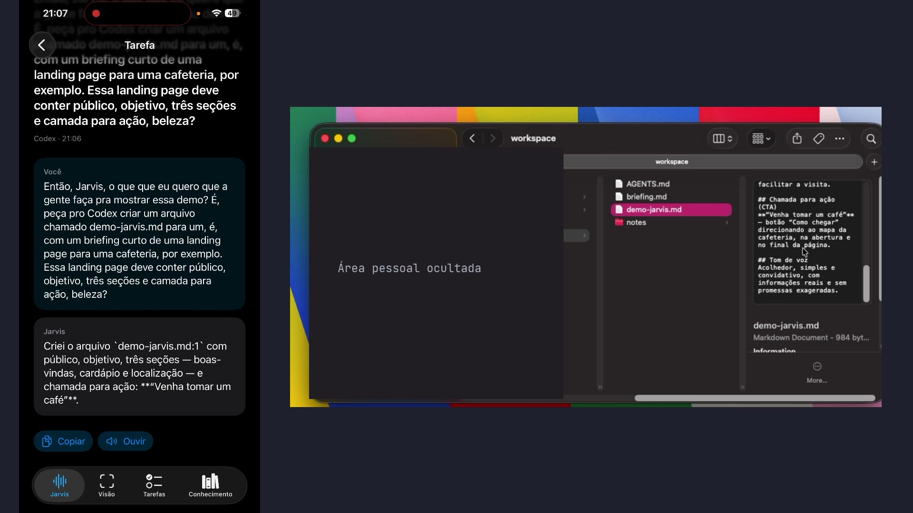

# Jarvis

Projeto de portfólio: um pedido por voz no iPhone vira uma tarefa para um agente de terminal no Mac, com andamento, aprovação e resultado no app. O recorte demonstrado é **voz → Codex → arquivo criado**. É um protótipo local, não um serviço hospedado.

## Demonstração

[](docs/media/jarvis-demo.mp4)

[Assistir ao vídeo de 1:03](docs/media/jarvis-demo.mp4). A gravação mostra um pedido real no iPhone, a tarefa executada pelo Codex e `demo-jarvis.md` criado no Mac. A edição corta parte da espera, indica uma aprovação feita no iPhone e oculta pastas e atividade pessoais. Algumas abas visíveis no vídeo pertencem a uma versão local experimental e não estão nesta `main`.

O vídeo comprova esse fluxo específico. Não comprova uso contínuo, todos os caminhos de aprovação/cancelamento, nem câmera e áudio simultâneos nos óculos.

## Como funciona

```text
iPhone (SwiftUI, voz e tarefas)
    ├──► gateway Node.js no Mac ──► adaptador Codex ──► workspace fixado no início
    │       tarefa, andamento, aprovação e credencial efêmera de voz
    └──► xAI Realtime, com credencial efêmera, para a conversa falada
```

O gateway aceita uma tarefa por vez, associa aprovações ao pedido e exige token mesmo na rede local; o iPhone guarda esse token no Keychain. O workspace é fixado ao iniciar o processo. Há também adaptadores para Claude Code e Grok Code; a demo de criação de arquivo usa Codex. O app inclui integração com Meta Wearables DAT para sessão e câmera dos óculos, e usa Apple Speech para detectar “Jarvis”.

## Avaliar sem óculos ou serviços pagos

Com Node.js 22.18+ e npm, na raiz do projeto:

```bash
npm ci
npm test
npm run typecheck
```

Esses testes usam agentes simulados e não enviam pedidos a modelos. Com Xcode, o [modo de prévia no simulador](apps/ios/README.md#ui-e-prévia-do-simulador) mostra os estados de voz e tarefas sem gateway ou hardware; ele **não executa** o fluxo gravado. Os [testes Swift locais](apps/ios/tests/README.md) também não exigem chamadas pagas.

Para reproduzir o fluxo completo, é preciso um Mac com Codex instalado e autenticado, iPhone físico, óculos Meta configurados e uma chave xAI com acesso à API de voz. O uso do Codex e da xAI depende dos respectivos serviços e pode ter custo. Veja [configuração e roteiro](docs/SETUP.md).

## Evidências e limites

- **Implementado:** gateway local, adaptadores Codex/Claude/Grok, tarefas com andamento, aprovação, cancelamento e recuperação de estado; interface iOS, voz xAI e integração Meta DAT.
- **Verificado por testes:** contratos do gateway e dos agentes simulados, typecheck e testes Swift descritos no repositório. Isso não substitui o aparelho físico.
- **Verificado em hardware:** criação/edição com Codex e leitura com Grok em testes anteriores; o vídeo mostra um pedido que criou um arquivo. A voz e a câmera dos óculos têm evidências históricas separadas, sem prova de operação simultânea contínua nesta versão.
- **Pendente:** teste real de Claude Code, cobertura física de interrupção/recusa/cancelamento e validação prolongada de câmera com áudio. Os demais recursos em [roadmap](docs/ROADMAP.md) são propostas.

Veja o [estado detalhado e as fontes de evidência](docs/JARVIS_STATUS.md) e as [decisões de execução dos agentes](docs/TERMINAL_AGENTS.md). Licença [MIT](LICENSE).
